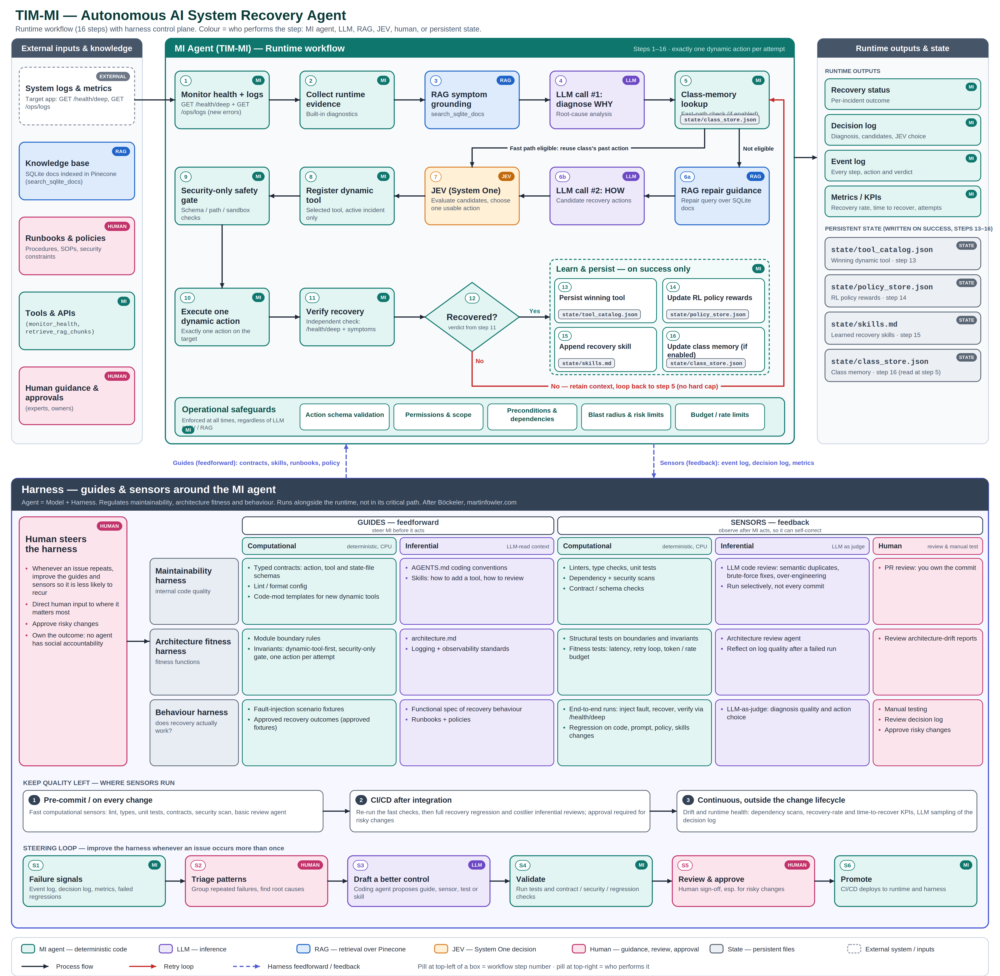

# MI Recovery Agent

MI is a diagnostics-first autonomous recovery agent for a SQLite-backed target service.

The runtime enforces a strict loop:

1. Monitor target health + new error logs (`GET /health/deep` + `GET /ops/logs`).
2. Collect runtime evidence using built-in diagnostics.
3. Run RAG symptom grounding (`search_sqlite_docs`).
4. LLM call #1: diagnose **WHY**.
5. Class-memory lookup (if enabled): score incident class + fast-path eligibility.
6. If fast-path is not eligible, run RAG repair guidance.
7. If fast-path is not eligible, run LLM call #2 (**HOW** candidates).
8. JEV (System One): evaluate candidate actions and choose one usable action.
9. Security-only safety gate (schema/path/sandbox checks before execution).
10. Register the selected dynamic tool for the active incident.
11. Execute exactly one dynamic action.
12. Verify recovery independently.
13. Persist only the winning dynamic tool to `state/tool_catalog.json`.
14. Update RL policy rewards in `state/policy_store.json`.
15. Append learned successful recovery skill to `state/skills.md`.
16. Update class-memory store in `state/class_store.json` (if enabled).

If verification fails, retain context and loop back to step 5 (no hard cap).
Before each retry MI re-checks target health (step 1); if the target is already healthy,
for example repaired by an operator, the incident closes without recording a learned success.

## Architecture Diagram


## Runtime guarantees

- No hard cap on retries/no-viable loops.
- Dynamic recovery actions are session-first; built-ins are diagnostics-first.
- Class-memory fast path does not bypass JEV, security gate, or verifier.
- Class-memory fast path is mandatory at runtime (cannot be disabled).
- `request_backup_restore` remains available.
- `restart_service` is optional fallback only.
- Startup config gate requires OpenAI + JEV + Pinecone credentials and class-memory enabled.

## WHY / HOW prompts (what the LLM is given)

Both prompts live in `src/mi_agent/llm/client.py` (`WHY_INSTRUCTION`, `HOW_INSTRUCTION`).
They describe the agent's role, the evidence fields and the action interface, and nothing
else: no fault names, no statement that a fault is simulated, no preferred repair. Which
repair works is learned from verified outcomes (policy store, class memory, skills).
`tests/test_llm_client.py` enforces this.

| Stage | Input | Output |
| --- | --- | --- |
| WHY | `evidence` = `health_deep`, `db_status`, `db_integrity`, `runtime_paths` (incl. `app_root`, `sandbox_root`), `app_schema` (the app's own DDL), `log_tail`, `log_collection`, `backups`; `rag_chunks` (SQLite docs) | `failure_type` (root-cause label), `hypotheses` (ranked), `evidence` (quoted input values) |
| HOW | `diagnosis`, `incident_state` (the evidence above minus logs), `backup_catalog`, `prior_attempts` (tool error + post-attempt verifier state), `latest_tool_error`, `rag_chunks` (docs + learned skills) | `primary` + 2–4 `alternatives`, each `{name, rationale, operation, params}` with the exact param keys of `src/mi_agent/tools/schemas.py` |

JEV then selects one candidate; the security gate, single execution and the verifier follow.

### Simulated faults stay invisible to MI

The target's test hooks (`TARGET_TEST_HOOKS=1`) break the database and write nothing to
the app log; MI only observes the resulting symptoms through `/health/deep`, `/ops/logs`,
`/ops/db/status` and `/ops/backups`. `tests/test_tools_executor.py::test_diagnostics_after_a_simulated_fault_carry_symptoms_but_no_trace_of_the_fault`
and the CI `docker-build-smoke` job enforce it.

### Honest health

`/health/deep` checks integrity, the `widgets` columns and a rolled-back test insert
(`write_check`), so a repair that leaves the table unable to accept the app's writes is
reported unhealthy (`write_failed`) and MI keeps working.

## Target app surface

- `GET /health/live`
- `GET /health/deep`
- `GET /ops/logs?lines=N`
- `GET /ops/db/status`
- `POST /widgets`
- `GET /widgets`
- `GET /ops/backups?limit=N` (backup catalog: `backup_id`, `created_at`, `size_bytes`, newest first)
- `POST /ops/backups/{backup_id}/restore`
- Test hooks, registered only when `TARGET_TEST_HOOKS=1` (the harness campaign sets it):
  - `POST /ops/fault/{delete_db|corrupt_db|drop_widgets_table}` (fault injection)
  - `POST /ops/reset` (rebuild a clean database from the schema)

## Project layout

- `src/mi_agent/agent/engine.py` – end-to-end recovery loop orchestrator.
- `src/mi_agent/tools/executor.py` – diagnostics + dynamic tool lifecycle + security gate.
- `src/mi_agent/llm/client.py` – OpenAI-backed WHY/HOW LLM client.
- `src/mi_agent/verifier/verifier.py` – independent recovery verifier.
- `src/mi_agent/api/server.py` – observability API (`/agent/status`, `/agent/events`, `/agent/tool-catalog`).
- `dashboard/index.html` – live operator dashboard (served by `/dashboard`).
- `target/app` – demo target service.

## Setup

```bash
python -m venv .venv
source .venv/bin/activate
pip install -e '.[dev,jev,rag,trace]'
```

## Jev local server (required)

Start Jev in a separate terminal:

```bash
cd .local/jev/jev
export JEV_API_KEY='<your-local-jev-secret>'
./jev serve --host 127.0.0.1 --port 8017
```

## Configuration

Copy `.env.example` and set values as needed.

LLM calls are mandatory. You can use OpenAI or Azure OpenAI.

OpenAI example:

- `OPENAI_API_KEY=<key>`

Azure OpenAI example:

- `OPENAI_API_KEY=<azure-key>`
- `MI_LLM_ENDPOINT=https://<resource>.openai.azure.com/openai/v1/responses`
- `MI_LLM_AUTH_MODE=api_key`
- `MI_LLM_API_KEY_HEADER=api-key`
- `MI_LLM_MODEL=<azure-deployment-name>`

Optional LangSmith tracing (`trace` extra, installed in the Docker image): set
`LANGSMITH_TRACING=true` and `LANGSMITH_API_KEY=<key>` (optionally `LANGSMITH_PROJECT`).
Each WHY / HOW call becomes a trace (`llm.why` / `llm.how`) with an `openai.responses`
LLM span carrying token usage. Tracing only observes; it never changes the loop. It sends
the diagnostics, RAG chunks, backup catalog and model output to LangSmith, so leave it off
where that data must stay local.

Jev decision layer (mandatory, used after candidate-set assembly to choose one action):

- `MI_JEV_ENABLED=true`
- `JEV_API_KEY=<same value used to start jev serve>`
- `MI_JEV_MODEL=jev-latest`
- `MI_JEV_USABLE_THRESHOLD=0.65`
- `MI_JEV_BASE_URL=http://host.docker.internal:8017` (when running `mi-agent` in Docker)
- `MI_JEV_BASE_URL=http://127.0.0.1:8017` (when running `mi-agent` on host)

Class-memory / fast-path controls (mandatory):

- `MI_CLASSMEM_ENABLED=true`
- `MI_CLASSMEM_FASTPATH_ENABLED=true`
- `MI_CLASSMEM_DEDUPE_ENABLED=true`
- `MI_CLASSMEM_STORE_PATH=/state/class_store.json`
- `MI_CLASSMEM_JOIN_THRESHOLD=0.82`
- `MI_CLASSMEM_MARGIN_DELTA=0.08`
- `MI_CLASSMEM_TAU_CONF=0.80`
- `MI_CLASSMEM_N_MIN=3`
- `MI_CLASSMEM_COOLDOWN_SECONDS=30`

For Pinecone RAG (mandatory):

- `MI_RAG_ENABLED=true`
- `PINECONE_API_KEY=<key>`
- `PINECONE_INDEX_HOST=<host>`
- `PINECONE_NAMESPACE=sqlite-docs`
- `MI_RAG_QUERY_PREFIX=sqlite`
- `MI_RAG_QUERY_REWRITE=true`
- `MI_RAG_FETCH_DEPTH=10`

## Run

Recommended (Docker):

```bash
docker compose up --build --remove-orphans
```

By default the compose file publishes only to localhost:

- target app: `127.0.0.1:8080`
- MI API/dashboard: `127.0.0.1:8090`

This keeps the unauthenticated demo endpoints off external interfaces.

If either port is already in use, override host ports when starting compose:

```bash
TARGET_HOST_PORT=18080 MI_HOST_PORT=18090 docker compose up --build --remove-orphans
```

Optional (host Python process):

```bash
python -m mi_agent.main
```

The API listens on `:8090`.

Dashboard:

- `http://localhost:8090/dashboard`
- Polls every 1s (v1, HTTP polling).
- Live tab shows only active-incident recovery signals (healthy heartbeat ping is hidden).
- Timeline uses canonical workflow-step events, including class-memory lookup,
  path mode (`fast_path` vs `full_loop`), RAG phases, WHY/HOW, JEV request/result,
  dynamic tool execution, verification, and per-attempt outcome.
- History tab stores completed recovery records and allows per-incident trace inspection.
- Shows live workflow state, incident timeline, RL stats, tool catalog, WHY diagnosis,
  HOW proposals, and sanitized raw LLM traces.

On startup, the agent performs an LLM preflight request and refuses to start the
recovery loop if the LLM endpoint or credentials are invalid.

## Validation

```bash
ruff check .
pytest -q
mypy --strict src
mypy --strict harness
```

Run the same checks automatically before every commit (once per clone):

```bash
pre-commit install
```

By default, `pytest -q` excludes `live` tests. To run real OpenAI integration tests:

```bash
OPENAI_API_KEY=<key> pytest -q -m live
```

## Dashboard + LLM trace endpoints

- `GET /dashboard`
  - Serves `dashboard/index.html`.
- `GET /agent/dashboard`
  - Aggregated live state for UI panels:
    - agent state (`workflow_state`, active incident, last monitor)
    - latest-first timeline
    - RL summary (`attempts`, `reward_total`, `avg_reward` per action)
    - persisted dynamic tool catalog
    - latest WHY diagnosis
    - latest HOW block (`primary`, `alternatives[]`, executed marker)
- `GET /agent/llm-trace?incident_id=<id>`
  - Returns latest trace by default, or a specific incident trace.
  - Includes sanitized/redacted snippets of LLM request/response payloads.

## Quick live recovery test

1. Start stack with the test hooks: `TARGET_TEST_HOOKS=1 docker compose up --build`
2. Open dashboard: `http://127.0.0.1:8090/dashboard`
3. Inject fault: `curl -X POST http://127.0.0.1:8080/ops/fault/drop_widgets_table`
4. Observe:
   - monitor transitions to incident
   - WHY diagnosis updates
   - HOW primary + alternatives appears
   - one dynamic action executes per loop
   - verification/timeline events continue until recovery

## Live demo walkthrough (beginner-friendly)

1. Create env file from template:

   ```bash
   cp .env.example .env
   ```

2. Fill required placeholders in `.env`:

   - `OPENAI_API_KEY=<your-openai-or-azure-key>`
   - `JEV_API_KEY=<your-local-jev-secret>`
   - `PINECONE_API_KEY=<your-pinecone-key>`
   - `PINECONE_INDEX_HOST=<your-pinecone-index-host>`

3. Start Jev locally (separate terminal):

   ```bash
   cd .local/jev/jev
   export JEV_API_KEY='<your-local-jev-secret>'
   ./jev serve --host 127.0.0.1 --port 8017
   ```

4. Start MI + target stack:

   ```bash
   TARGET_TEST_HOOKS=1 docker compose up --build --remove-orphans
   ```

5. Open the dashboard:

   - `http://127.0.0.1:8090/dashboard`

6. Show normal behavior:

   - `curl http://127.0.0.1:8080/health/deep`
   - `curl http://127.0.0.1:8080/widgets`

7. Trigger a fault and show autonomous recovery:

   ```bash
   curl -X POST http://127.0.0.1:8080/ops/fault/drop_widgets_table
   ```

   Watch the dashboard timeline until the incident closes.

8. Optional quick verification:

   ```bash
   make check
   ```

Known demo limitation: this repository does not include end-user auth flows (registration/login);
it is an operator-facing recovery system plus a demo target service.

## Recording the demo

With the stack up (`TARGET_TEST_HOOKS=1`), record the dashboard through two live outages
(captions are drawn for the viewer only):

```bash
pip install playwright   # uses the local Chrome; or `playwright install chromium`
python scripts/record_demo.py --target-url http://127.0.0.1:8080 \
  --out site/demo.mp4 --poster site/demo-poster.png
```

## CI/CD and branch protection

Every PR and push to `main` runs `.github/workflows/ci.yml`:

| Required check | What it proves |
| --- | --- |
| `lint-type-test` | ruff, `mypy --strict` (src + harness), full offline pytest |
| `dependency-audit` | `pip-audit` over the runtime + dev dependency set |
| `docker-build-smoke` | both images build; target healthy, a simulated fault leaves no trace in its logs, reset recovers |

`main` is protected: changes land through a PR whose three checks pass on the latest
commit (no force pushes, no deletions, linear history). The live LLM + JEV + Pinecone
campaign runs on demand on the self-hosted runner
(`.github/workflows/live-e2e-fault-campaign.yml`). The landing page in `site/` is a static
site deployed to Vercel (`npx vercel deploy site --prod`).
