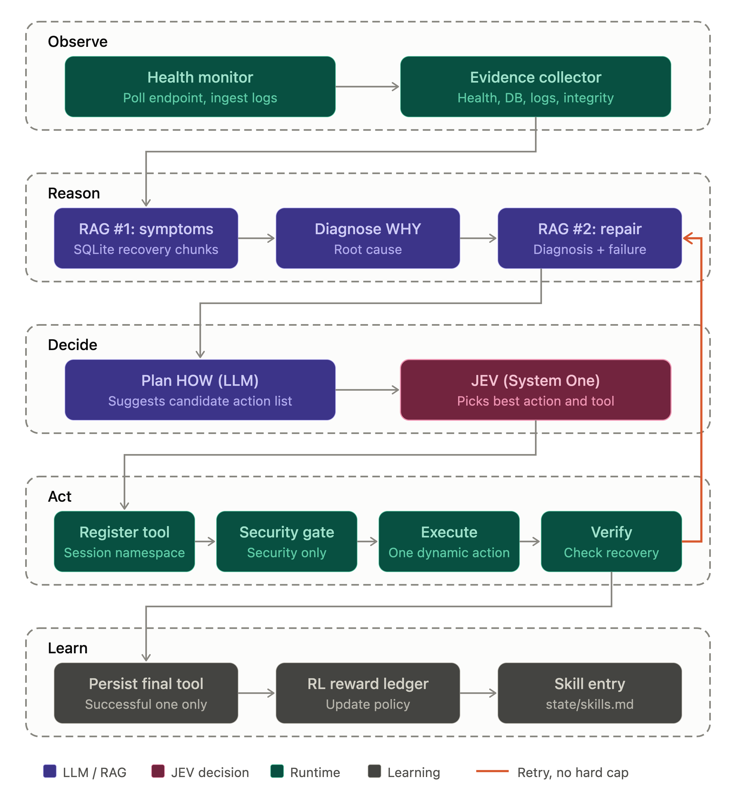

# MI Recovery Agent

MI is a diagnostics-first autonomous recovery agent for a SQLite-backed target service.

The runtime enforces a strict loop:

1. Monitor target health + new error logs (`GET /health/deep` + `GET /ops/logs`).
2. Collect runtime evidence using built-in diagnostics.
3. Run RAG symptom grounding (`search_sqlite_docs`).
4. LLM call #1: diagnose **WHY**.
5. Run RAG repair guidance with diagnosis context.
6. LLM call #2: propose **HOW** as a temporary dynamic tool.
7. Register the dynamic tool for the active incident.
8. Security-only safety gate (schema/path/sandbox checks).
9. Execute exactly one dynamic action.
10. Verify recovery independently.
11. On failure, feed back latest tool/verifier/fingerprint context and loop.
12. Persist only the winning dynamic tool to `state/tool_catalog.json`.
13. Update RL policy rewards in `state/policy_store.json`.
14. Append learned successful recovery skill to `state/skills.md`.

## Architecture Diagram


## Runtime guarantees

- No hard cap on retries/no-viable loops.
- Dynamic recovery actions are session-first; built-ins are diagnostics-first.
- `request_backup_restore` remains available.
- `restart_service` is optional fallback only.
- Startup config gate validates Pinecone requirements when `MI_RAG_ENABLED=true`.

## Target app surface

- `GET /health/live`
- `GET /health/deep`
- `GET /ops/logs?lines=N`
- `GET /ops/db/status`
- `POST /widgets`
- `GET /widgets`
- `POST /ops/fault/{delete_db|corrupt_db|drop_widgets_table}` (fault injection for recovery testing)

## Project layout

- `src/mi_agent/agent/engine.py` – end-to-end recovery loop orchestrator.
- `src/mi_agent/tools/executor.py` – diagnostics + dynamic tool lifecycle + security gate.
- `src/mi_agent/llm/client.py` – OpenAI-backed WHY/HOW LLM client.
- `src/mi_agent/verifier/verifier.py` – independent recovery verifier.
- `src/mi_agent/api/server.py` – observability API (`/agent/status`, `/agent/events`, `/agent/tool-catalog`).
- `dashboard/index.html` – live operator dashboard (served by `/dashboard`).
- `target/app` – demo target service.

## Setup

```bash
python -m venv .venv
source .venv/bin/activate
pip install -e .[dev]

# Optional: include Jev decision layer support
pip install -e .[dev,jev]
```

## Configuration

Copy `.env.example` and set values as needed.

OpenAI-backed LLM calls are mandatory:

- `OPENAI_API_KEY=<key>`

Optional Jev decision layer (inserted after HOW proposal to choose one candidate action):

- `MI_JEV_ENABLED=true`
- `JEV_API_KEY=<key>`
- `MI_JEV_MODEL=jev-latest`
- `MI_JEV_USABLE_THRESHOLD=0.65`

For Pinecone RAG:

- `MI_RAG_ENABLED=true`
- `PINECONE_API_KEY=<key>`
- `PINECONE_INDEX_HOST=<host>`

## Run

```bash
python -m mi_agent.main
```

The API listens on `:8090`.

Dashboard:

- `http://localhost:8090/dashboard`
- Polls every 1s (v1, HTTP polling).
- Shows live workflow state, incident timeline, RL stats, tool catalog, WHY diagnosis,
  HOW primary+alternatives, and sanitized raw LLM traces.

On startup, the agent performs an LLM preflight request and refuses to start the
recovery loop if the LLM endpoint or credentials are invalid.

## Validation

```bash
ruff check .
pytest -q
mypy --strict src
```

By default, `pytest -q` excludes `live` tests. To run real OpenAI integration tests:

```bash
OPENAI_API_KEY=<key> pytest -q -m live
```

## Dashboard + LLM trace endpoints

- `GET /dashboard`
  - Serves `dashboard/index.html`.
- `GET /agent/dashboard`
  - Aggregated live state for UI panels:
    - agent state (`workflow_state`, active incident, last monitor)
    - latest-first timeline
    - RL summary (`attempts`, `reward_total`, `avg_reward` per action)
    - persisted dynamic tool catalog
    - latest WHY diagnosis
    - latest HOW block (`primary`, `alternatives[]`, executed marker)
- `GET /agent/llm-trace?incident_id=<id>`
  - Returns latest trace by default, or a specific incident trace.
  - Includes sanitized/redacted snippets of LLM request/response payloads.

## Quick live recovery test

1. Start stack: `docker compose up --build`
2. Open dashboard: `http://localhost:8090/dashboard`
3. Inject fault: `curl -X POST http://localhost:8080/ops/fault/drop_widgets_table`
4. Observe:
   - monitor transitions to incident
   - WHY diagnosis updates
   - HOW primary + alternatives appears
   - one dynamic action executes per loop
   - verification/timeline events continue until recovery
